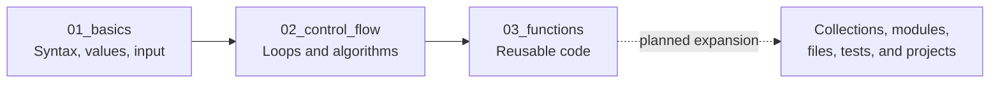

<h1 align="center">🐍 Python Complete Journey</h1>

<p align="center">
  <strong>Small programs, clear concepts, and a steadily growing Python practice path.</strong>
</p>

<p align="center">
  <a href="https://github.com/Rami-Manan/Python-Complete-Journey">
    
  </a>
</p>

This repository is a hands-on Python learning log: a sequence of numbered programs that moves from basic syntax, values, and input through control flow, problem-solving algorithms, reusable functions, flexible arguments, and recursion.

It is intended for **Python beginners** and learners who want to build confidence by reading, running, modifying, and extending small, focused examples.

> **Scope note:** This README documents the source tree currently being updated in this checkout. Relative links follow that tree; if a different Git branch contains a different set of examples, its file list may vary.

<a id="table-of-contents"></a>

## 📌 Table of Contents

- [📖 About This Repository](#about-this-repository)
- [🎯 Learning Objectives](#learning-objectives)
- [✨ Features and Repository Highlights](#features-and-repository-highlights)
- [📂 Repository Structure](#repository-structure)
- [🗺️ Python Learning Roadmap](#python-learning-roadmap)
- [🧠 Concepts Covered](#concepts-covered)
- [🛠️ Technologies Used](#technologies-used)
- [⚙️ Installation and Setup](#installation-and-setup)
- [💻 Code Examples and Usage](#code-examples-and-usage)
- [📚 How to Use This Repository](#how-to-use-this-repository)
- [📸 Screenshots and Visual Previews](#screenshots-and-visual-previews)
- [📈 Learning Progress](#learning-progress)
- [🚀 Future Improvements](#future-improvements)
- [🤝 Contributing](#contributing)
- [📄 License](#license)
- [👨‍💻 Author](#author)
- [⭐ Support](#support)

---

<a id="about-this-repository"></a>

## 📖 About This Repository

**Python Complete Journey** is organized as a practical progression rather than a packaged application. Each numbered script focuses on one small idea or problem so that the underlying Python syntax and logic stay visible.

The current checkout contains **50 Python programs** across three learning stages:

| Stage | Directory | Verified focus | Programs |
| --- | --- | --- | ---: |
| 1 | [`01_basics/`](01_basics/) | Syntax, values, input, operators, formulas, comparisons, and type inspection | 25 |
| 2 | [`02_control_flow/`](02_control_flow/) | Loops, digit algorithms, number checks, sequences, patterns, GCD, and LCM | 20 |
| 3 | [`03_functions/`](03_functions/) | Function definitions, return values, default arguments, `*args`, `**kwargs`, and recursion | 5 |

The numbering makes it easy to follow the intended direction: start with the first examples, then move into repeated computation and finally reusable functions. Most files are standalone command-line demonstrations, so learners can inspect one file and run it without installing a framework or a third-party package.

The repository was created to make Python progress visible through practice. Instead of hiding the learning process behind one large application, it keeps the experiments small enough to compare, modify, and revisit.

---

<a id="learning-objectives"></a>

## 🎯 Learning Objectives

The source code provides evidence for the following learning stages. A stage listed here means that related code exists; it does **not** claim that the topic is finished or mastered.

| Learning stage | Skills represented in the repository | Example evidence |
| --- | --- | --- |
| Python fundamentals | Console output, comments/docstrings, variables, built-in types, `type()`, `id()`, and basic formatting | [`001_hello_world.py`](01_basics/001_hello_world.py), [`003_variables_and_datatypes.py`](01_basics/003_variables_and_datatypes.py), [`022_type_and_id.py`](01_basics/022_type_and_id.py) |
| Input, conversion, and operators | `input()`, numeric casting, arithmetic, modulo, integer division, f-strings, and tuple unpacking | [`002_add_two_numbers.py`](01_basics/002_add_two_numbers.py), [`019_seconds_to_hms.py`](01_basics/019_seconds_to_hms.py), [`020_type_conversion.py`](01_basics/020_type_conversion.py) |
| Conditional logic | `if`/`elif`/`else`, comparisons, boolean expressions, and simple validation branches | [`006_simple_calculator.py`](01_basics/006_simple_calculator.py), [`015_check_even_odd.py`](01_basics/015_check_even_odd.py), [`038_check_leap_year.py`](02_control_flow/038_check_leap_year.py) |
| Repetition and control flow | `for`, `range()`, nested loops, running totals, digit extraction, and sequence generation | [`026_even_numbers_1_to_n.py`](02_control_flow/026_even_numbers_1_to_n.py), [`031_reverse_a_number.py`](02_control_flow/031_reverse_a_number.py), [`043_fibonacci_series.py`](02_control_flow/043_fibonacci_series.py) |
| Problem-solving practice | Prime, palindrome, Armstrong-number, factorial, pattern, GCD, and LCM exercises | [`034_check_prime.py`](02_control_flow/034_check_prime.py), [`036_check_armstrong.py`](02_control_flow/036_check_armstrong.py), [`044_gcd_loop.py`](02_control_flow/044_gcd_loop.py) |
| Reusable functions | Function declarations, parameters, docstrings, return values, default parameters, variable positional arguments, and variable keyword arguments | [`046_simple_function.py`](03_functions/046_simple_function.py), [`047_function_default_args.py`](03_functions/047_function_default_args.py), [`048_function_args.py`](03_functions/048_function_args.py), [`049_function_kwargs.py`](03_functions/049_function_kwargs.py) |
| Recursion | Base cases and recursive calls using factorial as the worked example | [`050_recursive_factorial.py`](03_functions/050_recursive_factorial.py) |

Topics such as object-oriented programming, file I/O, exception handling with `try`/`except`, testing, packaging, data analysis, and third-party libraries are not represented as dedicated material in the current tree.

---

<a id="features-and-repository-highlights"></a>

## ✨ Features and Repository Highlights

- **Numbered learning sequence:** Programs `001` through `050` make the practice order easy to scan.
- **Topic-based folders:** The three directories separate fundamentals, control flow, and functions without introducing unnecessary project scaffolding.
- **Practical examples:** The collection includes calculators, unit conversion, geometry, interest, BMI, number properties, multiplication tables, patterns, Fibonacci, GCD, and LCM.
- **Reusable-code examples:** The functions section demonstrates return values, default parameters, `*args`, and `**kwargs`.
- **Readable explanations:** Most scripts begin with a short docstring describing the program and the idea being practiced.
- **Standard-library-only runtime:** The examples use Python itself plus the standard-library modules `math`, `cmath`, and `sys`; no third-party installation is required.
- **Small files for experimentation:** Each program can be opened, run, and modified independently.

The repository does **not** currently include a package entry point, a dependency manifest, a test suite, CI configuration, screenshots, or a separate mini-project directory. Those are potential improvements, not existing features.

---

<a id="repository-structure"></a>

## 📂 Repository Structure

The tree below mirrors the current checkout. The complete list is shown because the repository is intentionally small enough to browse file by file.

```text
Python-Complete-Journey/
├── .gitignore
├── README.md
├── 01_basics/
│   ├── 001_hello_world.py
│   ├── 002_add_two_numbers.py
│   ├── 003_variables_and_datatypes.py
│   ├── 004_swap_with_temp.py
│   ├── 005_swap_without_temp.py
│   ├── 006_simple_calculator.py
│   ├── 007_celsius_to_fahrenheit.py
│   ├── 008_fahrenheit_to_celsius.py
│   ├── 009_area_of_circle.py
│   ├── 010_area_of_rectangle.py
│   ├── 011_area_of_triangle.py
│   ├── 012_simple_interest.py
│   ├── 013_compound_interest.py
│   ├── 014_bmi_calculator.py
│   ├── 015_check_even_odd.py
│   ├── 016_check_sign.py
│   ├── 017_largest_of_two.py
│   ├── 018_largest_of_three.py
│   ├── 019_seconds_to_hms.py
│   ├── 020_type_conversion.py
│   ├── 021_multiple_assignment.py
│   ├── 022_type_and_id.py
│   ├── 023_input_and_type.py
│   ├── 024_ascii_value.py
│   └── 025_quadratic_roots.py
├── 02_control_flow/
│   ├── 026_even_numbers_1_to_n.py
│   ├── 027_sum_of_natural_numbers.py
│   ├── 028_factorial_loop.py
│   ├── 029_multiplication_table.py
│   ├── 030_all_tables_1_to_10.py
│   ├── 031_reverse_a_number.py
│   ├── 032_sum_of_digits.py
│   ├── 033_check_palindrome_number.py
│   ├── 034_check_prime.py
│   ├── 035_primes_up_to_n.py
│   ├── 036_check_armstrong.py
│   ├── 037_armstrong_up_to_n.py
│   ├── 038_check_leap_year.py
│   ├── 039_pattern_right_triangle.py
│   ├── 040_pattern_pyramid.py
│   ├── 041_pattern_inverted_triangle.py
│   ├── 042_number_pattern.py
│   ├── 043_fibonacci_series.py
│   ├── 044_gcd_loop.py
│   └── 045_lcm_loop.py
└── 03_functions/
    ├── 046_simple_function.py
    ├── 047_function_default_args.py
    ├── 048_function_args.py
    ├── 049_function_kwargs.py
    └── 050_recursive_factorial.py
```

### Directory guide

| Path | Purpose |
| --- | --- |
| [`01_basics/`](01_basics/) | First programs for output, variables, types, input, arithmetic, formulas, comparisons, and small calculations. |
| [`02_control_flow/`](02_control_flow/) | Repetition and decision-making exercises, including number algorithms and printed patterns. |
| [`03_functions/`](03_functions/) | A progression from a simple return-value function to defaults, `*args`, `**kwargs`, and recursion. |
| [`.gitignore`](.gitignore) | Python-oriented ignore rules for caches, virtual environments, build output, IDE files, and related tooling artifacts. |
| [`README.md`](README.md) | This navigation and usage guide. |

One filename deserves a clarification: [`01_basics/021_multiple_assignment.py`](01_basics/021_multiple_assignment.py) currently implements an in-place “move zeros to the end” algorithm while retaining its original filename. The README describes its code, not the misleading filename.

---

<a id="python-learning-roadmap"></a>

## 🗺️ Python Learning Roadmap

The verified learning path can be summarized as:



The solid arrows represent material that exists in the repository. The dotted arrow is deliberately labeled as planned: the destination topics are suggestions for future growth, not claims about current implementation.

### Suggested order

1. Run [`001_hello_world.py`](01_basics/001_hello_world.py) and inspect the surrounding basics.
2. Work through the input, conversion, comparison, and formula examples in [`01_basics/`](01_basics/).
3. Move to [`02_control_flow/`](02_control_flow/) for loops, digit manipulation, number checks, sequences, and patterns.
4. Continue with [`03_functions/`](03_functions/) to turn repeated ideas into reusable functions.
5. Finish the current sequence with [`050_recursive_factorial.py`](03_functions/050_recursive_factorial.py), then use the future-improvement ideas below to choose the next topic.

---

<a id="concepts-covered"></a>

## 🧠 Concepts Covered

| Category | What the code demonstrates | Representative source |
| --- | --- | --- |
| Console output and documentation | `print()`, comments, module docstrings, and formatted output | [`001_hello_world.py`](01_basics/001_hello_world.py) |
| Variables and built-in types | `int`, `float`, `str`, `bool`, `list`, `tuple`, `dict`, and `set` | [`003_variables_and_datatypes.py`](01_basics/003_variables_and_datatypes.py) |
| Input and type conversion | Reading values with `input()`, converting strings to numbers, and observing input types | [`002_add_two_numbers.py`](01_basics/002_add_two_numbers.py), [`020_type_conversion.py`](01_basics/020_type_conversion.py), [`023_input_and_type.py`](01_basics/023_input_and_type.py) |
| Assignment and mutation | Temporary-variable swaps, tuple-unpacking swaps, list mutation, and `ord()`/`chr()` conversions | [`004_swap_with_temp.py`](01_basics/004_swap_with_temp.py), [`005_swap_without_temp.py`](01_basics/005_swap_without_temp.py), [`024_ascii_value.py`](01_basics/024_ascii_value.py) |
| Arithmetic and formulas | Unit conversion, geometry, simple and compound interest, BMI, time decomposition, and quadratic roots | [`007_celsius_to_fahrenheit.py`](01_basics/007_celsius_to_fahrenheit.py), [`011_area_of_triangle.py`](01_basics/011_area_of_triangle.py), [`025_quadratic_roots.py`](01_basics/025_quadratic_roots.py) |
| Branching | Operator selection, even/odd checks, sign checks, maximum values, and leap-year logic | [`006_simple_calculator.py`](01_basics/006_simple_calculator.py), [`017_largest_of_two.py`](01_basics/017_largest_of_two.py), [`038_check_leap_year.py`](02_control_flow/038_check_leap_year.py) |
| Loops and ranges | Iteration, running totals, factorial, multiplication tables, and nested loops | [`027_sum_of_natural_numbers.py`](02_control_flow/027_sum_of_natural_numbers.py), [`030_all_tables_1_to_10.py`](02_control_flow/030_all_tables_1_to_10.py) |
| Digit and number algorithms | Reversal, digit sums, palindromes, primes, Armstrong numbers, GCD, and LCM | [`031_reverse_a_number.py`](02_control_flow/031_reverse_a_number.py), [`034_check_prime.py`](02_control_flow/034_check_prime.py), [`045_lcm_loop.py`](02_control_flow/045_lcm_loop.py) |
| Sequences and patterns | Fibonacci terms, right triangles, pyramids, inverted triangles, and number patterns | [`039_pattern_right_triangle.py`](02_control_flow/039_pattern_right_triangle.py), [`040_pattern_pyramid.py`](02_control_flow/040_pattern_pyramid.py), [`043_fibonacci_series.py`](02_control_flow/043_fibonacci_series.py) |
| Functions | Parameters, return values, default parameters, `*args`, and `**kwargs` | [`046_simple_function.py`](03_functions/046_simple_function.py), [`049_function_kwargs.py`](03_functions/049_function_kwargs.py) |
| Recursion | Base case plus recursive case using factorial | [`050_recursive_factorial.py`](03_functions/050_recursive_factorial.py) |

---

<a id="technologies-used"></a>

## 🛠️ Technologies Used

| Technology or tool | How it is used | Evidence or note |
| --- | --- | --- |
| Python | Runs all 50 learning programs | The code uses Python 3 features such as f-strings in multiple files. |
| `math` | Pi, square roots, and prime checks | [`009_area_of_circle.py`](01_basics/009_area_of_circle.py), [`011_area_of_triangle.py`](01_basics/011_area_of_triangle.py), [`034_check_prime.py`](02_control_flow/034_check_prime.py) |
| `cmath` | Square roots that can produce complex values | [`025_quadratic_roots.py`](01_basics/025_quadratic_roots.py) |
| `sys` | Reading whitespace-separated batch input | [`021_multiple_assignment.py`](01_basics/021_multiple_assignment.py) |
| Git and GitHub | Version control and repository hosting | [Repository home](https://github.com/Rami-Manan/Python-Complete-Journey) |

There are no third-party imports and no `requirements.txt`, `pyproject.toml`, or other dependency manifest in the current tree. A Python interpreter and its standard library are sufficient.

---

<a id="installation-and-setup"></a>

## ⚙️ Installation and Setup

### Prerequisites

- Git
- Python 3.6 or newer is the practical baseline for most files because the collection uses f-strings. The repository does not currently pin a Python version.
- A terminal such as PowerShell, Command Prompt, or a Unix-like shell

### Clone the repository

```bash
git clone https://github.com/Rami-Manan/Python-Complete-Journey.git
cd Python-Complete-Journey
```

Check the interpreter available on your machine:

```bash
python --version
```

On Windows, the Python launcher is also useful when more than one interpreter is installed:

```powershell
py -3 --version
```

### Optional virtual environment

The examples do not require external packages, so a virtual environment is optional. It can still keep local tooling isolated:

```bash
python -m venv .venv
```

Activate it with the command for your shell:

```powershell
# Windows PowerShell
.\.venv\Scripts\Activate.ps1
```

```bash
# macOS or Linux
source .venv/bin/activate
```

There is no dependency-installation step for the current repository; do not run `pip install -r requirements.txt` because that file does not exist.

### Run a program

Run commands from the repository root. This no-input example is a verified file in the tree:

```bash
python 01_basics/001_hello_world.py
```

For an interactive example, run the calculator and enter two numbers plus one of `+`, `-`, `*`, or `/` when prompted:

```bash
python 01_basics/006_simple_calculator.py
```

The same pattern works for every `.py` file shown in the structure above. On Windows, `py -3` can replace `python`:

```powershell
py -3 03_functions/050_recursive_factorial.py
```

---

<a id="code-examples-and-usage"></a>

## 💻 Code Examples and Usage

The examples below use files that are present in the repository. The sample outputs were checked by running the corresponding scripts in this checkout.

### 1. First output: `001_hello_world.py`

[`01_basics/001_hello_world.py`](01_basics/001_hello_world.py) introduces `print()` with a fixed greeting:

```python
print("Hello, World!")
```

Run it with:

```bash
python 01_basics/001_hello_world.py
```

Output:

```text
Hello, World!
```

### 2. Branching calculator: `006_simple_calculator.py`

[`01_basics/006_simple_calculator.py`](01_basics/006_simple_calculator.py) reads two floating-point numbers and selects an arithmetic branch from the operator entered by the user:

```python
if op == "+":
    result = num1 + num2
elif op == "*":
    result = num1 * num2
```

For the inputs `12`, `*`, and `3`, the verified result is:

```text
Result: 36.0
```

### 3. Looping sequence: `043_fibonacci_series.py`

[`02_control_flow/043_fibonacci_series.py`](02_control_flow/043_fibonacci_series.py) maintains two rolling values and prints the requested number of Fibonacci terms:

```python
a, b = 0, 1
for _ in range(n):
    print(a, end=" ")
    a, b = b, a + b
```

Entering `7` produces:

```text
Fibonacci series:
0 1 1 2 3 5 8
```

### 4. Flexible function arguments: `048_function_args.py`

[`03_functions/048_function_args.py`](03_functions/048_function_args.py) uses `*args` to accept any number of numeric positional arguments:

```python
def total_sum(*args):
    total = 0
    for num in args:
        total += num
    return total
```

The file runs two built-in demonstrations and prints:

```text
6
100
```

### 5. Recursive factorial: `050_recursive_factorial.py`

[`03_functions/050_recursive_factorial.py`](03_functions/050_recursive_factorial.py) shows how a base case stops a recursive call chain:

```python
def factorial(n):
    if n == 0:
        return 1
    return n * factorial(n - 1)
```

Entering `5` produces:

```text
5! = 120
```

### 6. Batch input example: `021_multiple_assignment.py`

Despite its filename, [`01_basics/021_multiple_assignment.py`](01_basics/021_multiple_assignment.py) currently reads whitespace-separated data from standard input and moves zero values to the end of an array in place. A simple one-test input is:

```text
1 5 0 1 0 3 0
```

The verified output is:

```text
1 3 0 0 0
```

This file expects the first value to be a test count, followed by each array length and its values. The other interactive programs use `input()` prompts instead.

---

<a id="how-to-use-this-repository"></a>

## 📚 How to Use This Repository

Use the repository as a repeatable practice loop:

1. **Start with the foundations.** Begin in [`01_basics/`](01_basics/) and follow the numeric order.
2. **Read before running.** Look at the opening docstring, inputs, operators, and output statements.
3. **Run one script locally.** Use the commands in [Installation and Setup](#installation-and-setup) from the repository root.
4. **Change one thing.** Try a different input, operator, range, formula value, or function argument.
5. **Compare the behavior.** Pay attention to types, branches, loop boundaries, and formatted output.
6. **Move to control flow.** Use [`02_control_flow/`](02_control_flow/) to practice repetition and algorithmic thinking.
7. **Refactor into functions.** Continue with [`03_functions/`](03_functions/) and experiment with parameters, `*args`, `**kwargs`, and the recursive factorial example.

Most scripts execute their demonstration immediately when run. The exceptions worth remembering are:

- [`030_all_tables_1_to_10.py`](02_control_flow/030_all_tables_1_to_10.py) has no input and prints a fixed set of tables.
- The four non-recursive function examples use fixed demonstrations.
- [`021_multiple_assignment.py`](01_basics/021_multiple_assignment.py) consumes batch input with `sys.stdin.read()` rather than displaying prompts.

---

<a id="screenshots-and-visual-previews"></a>

## 📸 Screenshots and Visual Previews

No screenshot or image assets are currently stored in the repository, so this README does not fabricate or embed a preview that does not exist. The natural preview for this project is the terminal output produced by the runnable examples above.

If visual documentation is added later, it could show a short terminal session or a learner-friendly folder walkthrough using real repository paths.

---

<a id="learning-progress"></a>

## 📈 Learning Progress

The checklist reflects source evidence only. A checked item means that the repository contains a related example, not that the topic is complete.

- [x] Python output, variables, built-in data types, and type inspection
- [x] Input, numeric conversion, arithmetic, comparisons, and formatted strings
- [x] Conditional statements and simple validation branches
- [x] `for` loops, `range()`, nested loops, and running totals
- [x] Number exercises: factorial, primes, palindromes, Armstrong numbers, GCD, and LCM
- [x] Sequence and pattern exercises, including Fibonacci and star/number patterns
- [x] Functions with return values, defaults, `*args`, and `**kwargs`
- [x] A recursive factorial example with a base case
- [ ] Dedicated collections, strings, modules/packages, file handling, exception handling, OOP, tests, or larger projects

The existing material is a solid beginner-to-early-intermediate practice foundation. The unchecked topics are intentionally listed as future scope rather than presented as completed work.

---

<a id="future-improvements"></a>

## 🚀 Future Improvements

The following are realistic suggestions, not current features:

- Add dedicated chapters for lists, tuples, sets, dictionaries, and string operations.
- Add modules and packages to show how related code can be organized and imported.
- Add file-handling and `try`/`except` examples with input validation.
- Add object-oriented programming examples and one or two small, complete projects.
- Add focused exercises with problem statements, constraints, and expected outputs.
- Add automated tests and a lightweight CI workflow for syntax and behavior checks.
- Add consistent `if __name__ == "__main__":` entry-point guards where appropriate.
- Rename or clarify [`021_multiple_assignment.py`](01_basics/021_multiple_assignment.py) so its filename matches its current move-zeros implementation, or replace it with a true multiple-assignment example.
- Resolve the legacy Python 2 shebang in that same file and document one consistent interpreter target.
- Add short folder-level notes explaining prerequisites, input format, and learning takeaways.

---

<a id="contributing"></a>

## 🤝 Contributing

Suggestions and beginner-friendly improvements are welcome. A typical contribution workflow is:

1. Fork the repository on GitHub.
2. Clone your fork and create a focused branch:

   ```bash
   git clone https://github.com/<your-username>/Python-Complete-Journey.git
   cd Python-Complete-Journey
   git switch -c improve-example
   ```

3. Add or improve one example, explanation, or documentation section.
4. Run the affected script(s) and, when useful, check all source files for syntax errors:

   ```bash
   python -m compileall -q .
   ```

5. Commit the focused change and push the branch:

   ```bash
   git add .
   git commit -m "docs: clarify the learning path"
   git push origin improve-example
   ```

6. Open a pull request describing the learning goal, the files changed, and how the example was checked.

Please keep examples small, explain the concept they demonstrate, and avoid adding dependencies unless they are genuinely needed and documented.

---

<a id="license"></a>

## 📄 License

No `LICENSE`, `COPYING`, or `NOTICE` file was found in the repository. The licensing status has therefore **not been specified**. Do not assume that the code is released under an open-source license until the author adds one.

---

<a id="author"></a>

## 👨‍💻 Author

Created and maintained by [Rami-Manan](https://github.com/Rami-Manan) as a record of Python learning, programming practice, and problem-solving experiments.

---

<a id="support"></a>

## ⭐ Support

If this learning journey is useful, consider starring the repository, exploring the examples, suggesting a clear improvement, or sharing it with another Python learner.

<div align="center">

**Keep practicing, keep experimenting, and let every small Python program move you forward. 🐍**

</div>
